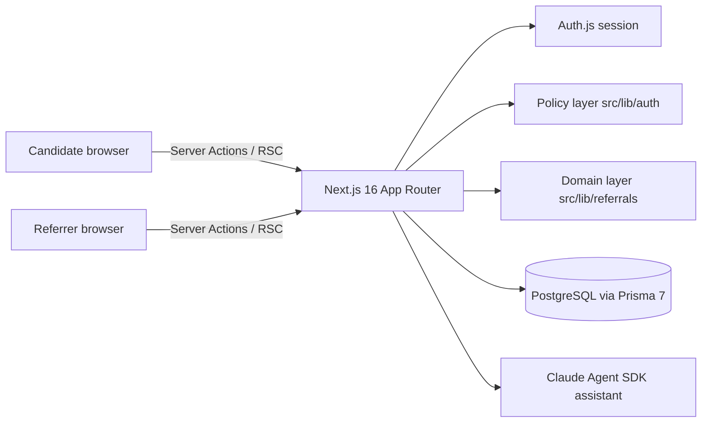
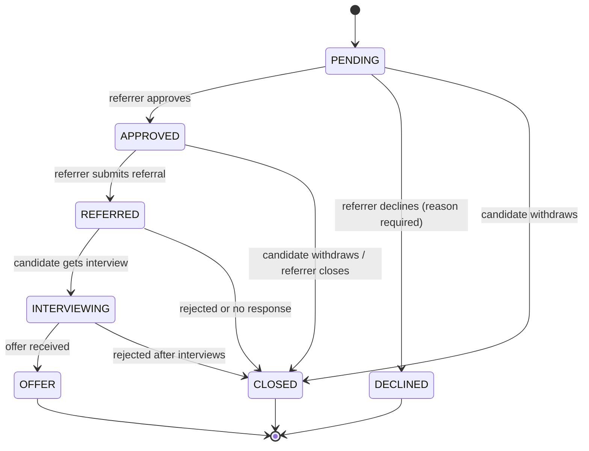

# ReferFlow Architecture

## Overview

Request flow for any mutation: **authenticate → validate input (Zod) → authorize (policy) → domain
rule (pure function) → persist in a Prisma transaction → revalidate the affected route**.

## Layers

| Layer   | Location                                | Depends on         | Tested with        |
| ------- | --------------------------------------- | ------------------ | ------------------ |
| UI      | `src/app/**`, `src/components`          | actions, policy    | Playwright         |
| Actions | `src/app/**/actions.ts`                 | policy, domain, db | Vitest integration |
| Policy  | `src/lib/auth/`                         | domain types only  | Vitest unit (TDD)  |
| Domain  | `src/lib/referrals/`                    | nothing (pure)     | Vitest unit (TDD)  |
| Data    | `prisma/schema.prisma`, `src/lib/db.ts` | Prisma Client      | Vitest integration |

## Domain model

- **User** — `role` is `CANDIDATE` or `REFERRER` (one role per account). Auth.js `Account` and
  `Session` hang off it.
- **ReferrerProfile** — 1:1 with a referrer user: `companies` they can refer to, `monthlyQuota`,
  `acceptingRequests`.
- **ReferralRequest** — candidate → referrer for one `company` + `roleTitle`, with `jobDescription`,
  `jobUrl`, `resumeUrl`, optional `candidateNote`, and the current `status`.
- **StatusChange** — append-only audit row for every transition (`from`, `to`, `actorId`, `reason`).
- **PrivateNote** — referrer-only note on a request. Never returned to a candidate.
- **InterviewFeedback** — referrer-written, candidate-visible feedback per interview round.

## Request status lifecycle

`DECLINED`, `OFFER` and `CLOSED` are terminal. The transition table lives in
`src/lib/referrals/status-machine.ts` and is the only place these rules are encoded.

## Quota rule

A referral counts against a referrer's monthly quota when it reaches `REFERRED` in that calendar
month (UTC). Approving is allowed only while `referredThisMonth + approvedNotYetReferred <
monthlyQuota`, so a referrer can't over-commit. A candidate can't open a second active request to
the same referrer for the same company + role (active = not terminal).

## Key decisions

| Decision                                 | Why                                                                         |
| ---------------------------------------- | --------------------------------------------------------------------------- |
| Pure domain functions, thin actions      | Business rules are TDD-able without a DB or Next runtime                    |
| One role per user                        | Matches the PRD; simplifies policy checks; can add multi-role later         |
| Separate PrivateNote / InterviewFeedback | A visibility flag is one bug away from leaking private notes                |
| Append-only StatusChange                 | Candidates get a timeline; audit trail for disputes (OWASP A09)             |
| Prisma 7 client generated into `src/`    | Prisma 7 default; keeps generated types next to the app code                |
| Server Actions over a separate REST API  | One deployable, colocated auth checks; route handlers only for AI streaming |
